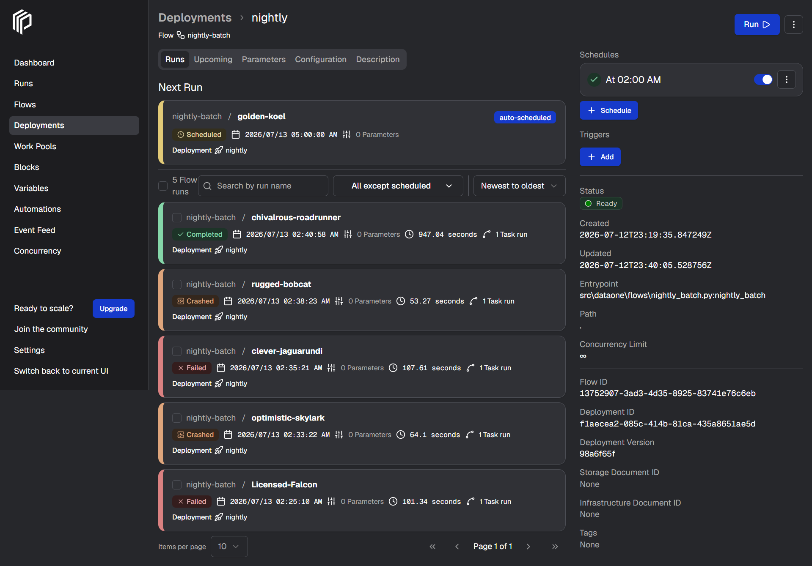
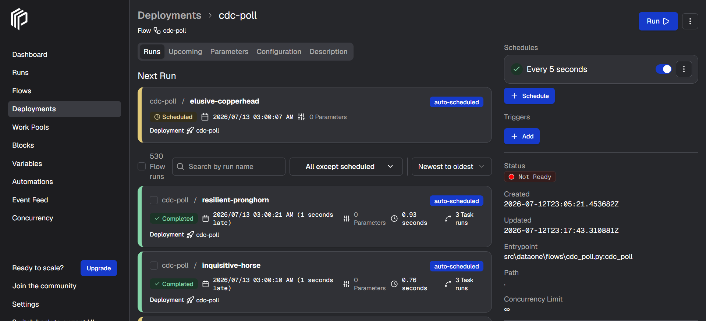

# Orchestration Guide (Prefect)

DataOne uses **Prefect 3.x** to orchestrate its core batch and interval-based pipelines. This replaces the legacy custom-built Python scheduler with a robust, production-grade orchestration tool without sacrificing the lightweight, local-first footprint required by this project.

---

## Why Prefect?

While Airflow and Dagster are also industry standards, Prefect was specifically chosen for this local laptop-scale environment because it offered the lowest friction for our architecture:
1. **Python-Native:** Prefect decorators (`@flow` and `@task`) map perfectly to our existing Python codebase. We did not need to adopt a rigid new DAG authoring paradigm.
2. **Resource Efficiency:** Prefect runs entirely out of our existing PostgreSQL metadata database (in a dedicated `prefect` logical DB) and reuses our existing Spark Docker image (`dataone-spark`) for its worker pool. This avoids the heavy footprint of running multiple JVMs, Celery workers, or separate Airflow webservers just for orchestration.
3. **Observability:** Prefect provides an out-of-the-box UI for tracking flow states, retries, and logs with zero extra configuration.

---

## Architecture & Infrastructure

Prefect runs via three dedicated services in the `core` profile of our `docker-compose.yml`:

- `prefect-server`: The core API and UI server, available at `http://localhost:4200`.
- `prefect-redis`: The messaging layer required by Prefect 3.x for event routing.
- `prefect-worker`: A worker for the `dataone-process-pool` process work pool, built from the same Docker image as `spark-worker-batch` (`x-spark-image`). No deployment targets that pool today, so it is idle: the flows below are started with Prefect's `serve()` and run in the process that serves them (see *Execution & Usage*).

---

## The Flows

The orchestration logic is located in `src/dataone/orchestration/`. There are three flows: `nightly-batch` and `backfill` (both in `nightly_batch.py`) and `cdc-poll` (`cdc_poll.py`).

### 1. Nightly Batch Pipeline (`nightly_batch.py`)



- **Trigger:** Runs via a Cron schedule (`0 2 * * *` - 02:00 AM daily).
- **Tasks:** Runs the four batch stages as separate Prefect tasks, in order: `run-ingest-bronze`, `run-standardize-silver`, `run-model-gold`, `run-clickhouse-sync`. Each task calls `make run-batch STAGE=<stage>` (one `spark-submit` per stage) and passes `PARENT_RUN_ID` / `PARENT_JOB_NAME` so the Spark job's OpenLineage events link back to the flow run. A final `publish-run-summary` task (in `finally`) publishes a Markdown summary of `_pipeline_runs` as a Prefect artifact.
- **Retries:** Each stage task retries 3 times with fixed delays of 10 s, 30 s and 60 s, so a failed ClickHouse sync is retried without re-running ingest or Silver.

### 2. Backfill (`nightly_batch.py`, `backfill(start, end)`)

- **Trigger:** On demand. It takes `start` and `end` dates and runs the same four stage tasks with `START_DATE` / `END_DATE` set. `make schedule` does not serve it, so run it from Python (`from dataone.orchestration.nightly_batch import backfill; backfill("2026-07-01", "2026-07-05")`) or use the standalone CLI `python -m dataone.batch.backfill`.

### 3. CDC Simulator Poller (`cdc_poll.py`)



- **Trigger:** Runs on a 5-second interval schedule (`cdc_poll.serve(name="cdc-poll", interval=5)`).
- **Task:** Repeatedly executes the `poll_once` function on our PostgreSQL tables (`customers` and `orders`) to detect changes and emit events into Kafka.
- **Features:** Provides high observability. If a specific poll cycle fails (e.g., due to a temporary DB lock), Prefect natively retries the task, and we can easily see exactly which interval failed rather than having a monolithic daemon crash silently.

---

## Execution & Usage

The Prefect server runs inside Docker, while the `make` targets below serve the flows from your machine with `serve()`: the process stays in the foreground, creates the deployment and its schedule on the server, and executes each run itself. Keep it running for the schedule to fire. Make sure that your `.env` contains the correct `PREFECT_API_URL` (usually `http://localhost:4200/api`) so the local Python script can communicate with the Dockerized server.

**Starting the nightly scheduler:**
```bash
make schedule
```

**Starting the CDC poller:**
```bash
make stream-cdc
```

**UI Dashboard:**
Navigate to `http://localhost:4200` to monitor runs, view task-level logs, configure deployments, and inspect pipeline health visually.
