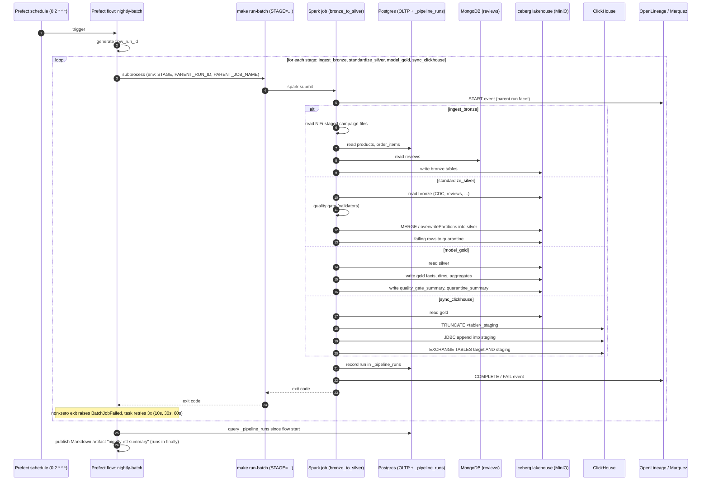
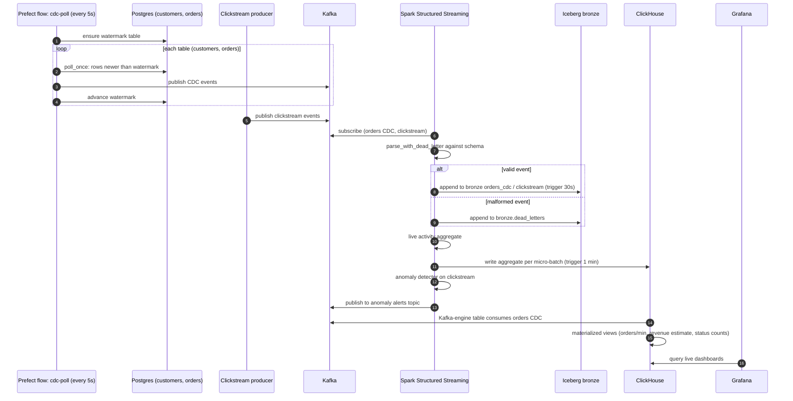
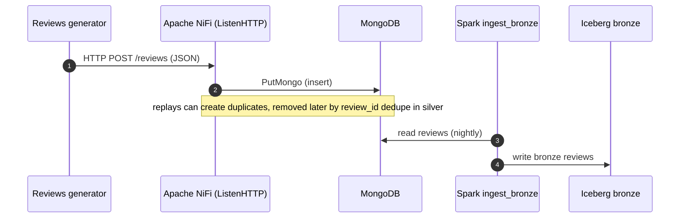
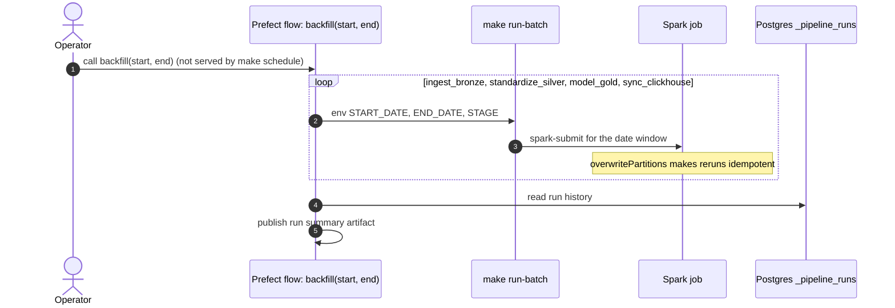
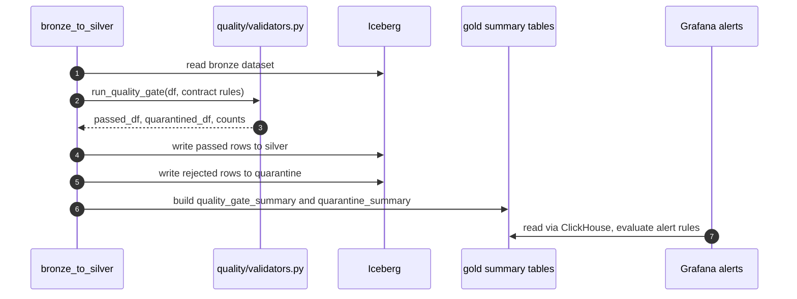

# DataOne sequence diagrams (Mermaid)

Derived from `src/dataone/orchestration/nightly_batch.py`, `cdc_poll.py`,
`streaming/structured_streaming_job.py` and `batch/bronze_to_silver.py`.
Details not visible in those files (exact NiFi processors, topic names) are kept generic.

## 1. Nightly batch (Prefect → Spark → Iceberg → ClickHouse)

## 2. Real-time path (CDC and clickstream via Kafka and Structured Streaming)

## 3. Review ingestion (NiFi → MongoDB → batch)

## 4. Backfill

## 5. Data quality and quarantine (inside standardize_silver)

